<div align="center">


# On Hold

### Pause before you pay.

An AI scam checker for older South Africans. Paste a message, share a screenshot or say what the caller said,<br/>and get a plain **Stop**, **Wait** or **Looks okay**, with what to do next. Family hears about it only if you say so.

[**Website**](https://onhold.pages.dev) &nbsp;·&nbsp; [**Try the app**](https://onhold-app.pages.dev) &nbsp;·&nbsp; [**Demo video**](#demo-video) &nbsp;·&nbsp; [**Live API**](https://on-hold-ashen.vercel.app/docs) &nbsp;·&nbsp; [**API routes**](backend/docs/api.md) &nbsp;·&nbsp; [**Bug log**](docs/testing.md)

[](https://github.com/victordupreez0/On-Hold/actions/workflows/ci.yml)


<br/>

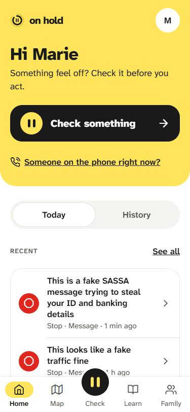
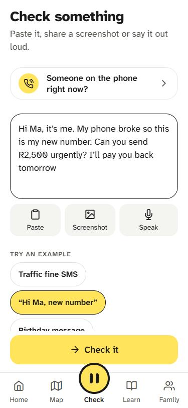
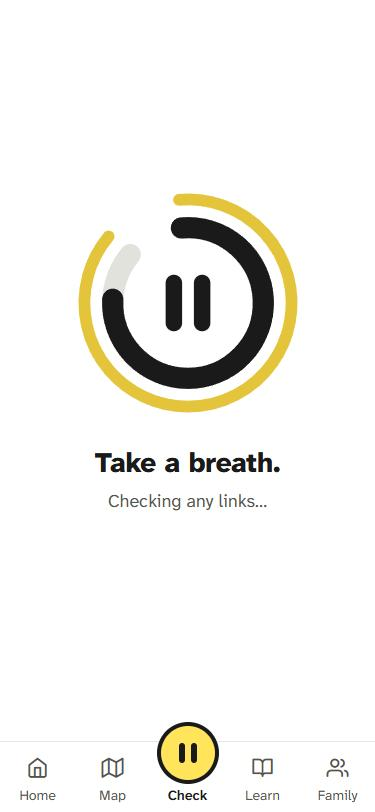
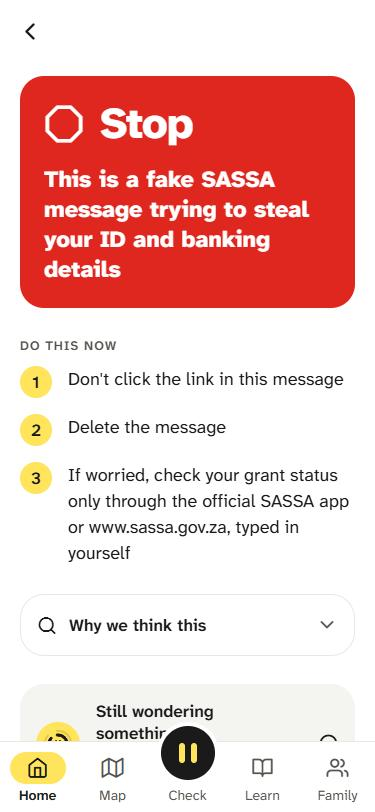
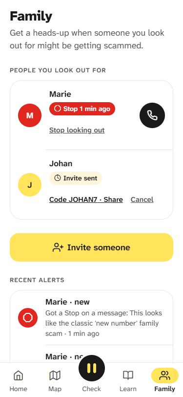

<sub>A real run: a screenshot of a fake SASSA SMS goes in, Claude reads it, Marie gets a <b>Stop</b>, and Pieter (her son, who she agreed can see warnings) gets an alert.</sub>

</div>

<br/>

DV300 Theme 4 (AI-Driven Application) · Social Impact and Accessibility · Victor du Preez (241250) · Open Window, 2026

## Contents

[The problem](#the-problem) · [What it does](#what-it-does) · [Screenshots](#screenshots) · [Demo video](#demo-video) · [Using the app](#using-the-app) · [How it works](#how-it-works) · [Run it yourself](#run-it-yourself) · [Deployment](#deployment) · [Technologies](#technologies) · [Security and privacy](#security-and-privacy) · [Testing](#testing) · [Project management](#project-management) · [Acknowledgements](#acknowledgements)

## The problem

Scammers in South Africa go after the moment between reading a message and acting on it: a "bank fraud department" call asking for an OTP, a SASSA SMS saying a grant is on hold, a "Hi Ma, this is my new number" WhatsApp. Older people are targeted most, and most often they're alone when it happens. The usual advice ("never share your OTP") is right, but in a pressured moment people need a quick, calm second opinion and a clear next step, and their family often only finds out afterwards.

**Who it's for:** older South Africans who are less confident with phones (the *protected* person), the adult children and grandchildren who look out for them (*guardians*), and moderators who keep the community data clean (*admins*).

## What it does

| Feature | |
|---|---|
| **Check** (the AI feature) | Paste a message, share a **screenshot**, or **speak** what a caller is saying. A short breathing pause (at least 3 s, deliberately) gives way to a verdict with reasons, next steps and, for calls, a "Say this, then hang up" line. Ask follow-up questions about any verdict in a chat that's saved to History. |
| **Family** | A guardian invites someone with a 6-character code or a WhatsApp share. Accepting shows exactly what is and isn't shared. Per-person sharing toggles, stop sharing any time. A Stop verdict alerts guardians **only if the person agreed**. "Tell my family" sends any check on purpose. |
| **Scam map** | Approved community reports per suburb as a heat map, filterable by scam type, with a ranked list of areas. Never more precise than a suburb. |
| **Report a scam** | Create, edit and delete your own reports. Every report is moderated before it reaches the map, and an edited report goes back to review. |
| **Learn** | "Going around near you" from the last 14 days of approved reports, plus 9 sourced guides to the common SA scams. |
| **Admin panel** | A dashboard (totals, active people this week, the 14-day trend), a live **activity feed** of what everyone is doing, **users** (last active, history, family links; add, edit, change role, delete), a **moderation queue** (approve, or reject with a reason the reporter sees), and full CRUD on Learn guides and suburbs. |
| **Accessibility** | Simple mode (one giant Check button plus "Call Pieter"), Atkinson Hyperlegible Next, 48 pt touch targets, verdicts always icon + word + colour, screen-reader labels throughout. |

## Screenshots

<table>
  <tr>
    <th colspan="3">Check: the AI feature</th>
  </tr>
  <tr>
    <td align="center"><br/><sub>Paste, screenshot or speak</sub></td>
    <td align="center"><br/><sub>A deliberate 3-second pause</sub></td>
    <td align="center"><br/><sub>The verdict and what to do now</sub></td>
  </tr>
  <tr>
    <th colspan="3">Every day</th>
  </tr>
  <tr>
    <td align="center"><br/><sub>Home: recent checks, one tap to check</sub></td>
    <td align="center">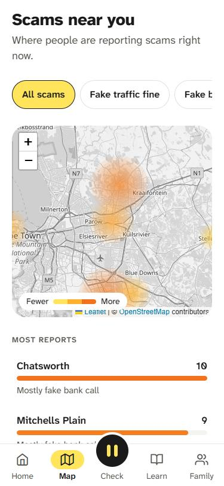<br/><sub>Community scam map, by suburb</sub></td>
    <td align="center">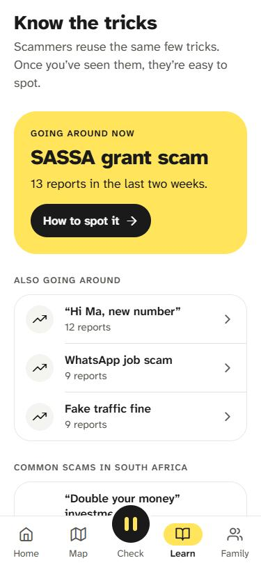<br/><sub>What's going around, and how to spot it</sub></td>
  </tr>
  <tr>
    <th colspan="3">Family</th>
  </tr>
  <tr>
    <td align="center">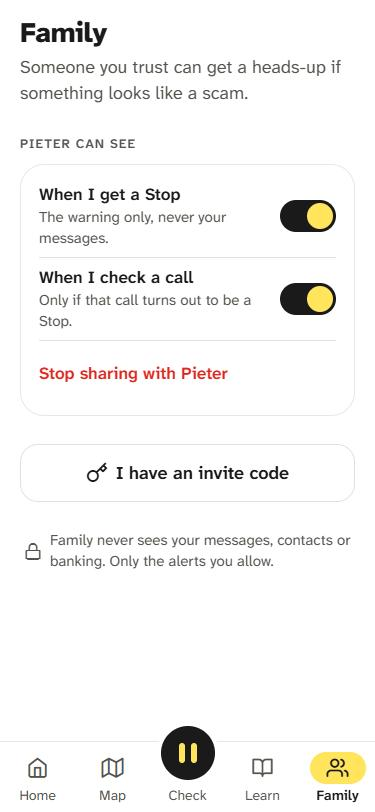<br/><sub>Marie chooses what Pieter can see</sub></td>
    <td align="center"><br/><sub>Pieter gets her Stop alerts</sub></td>
    <td align="center">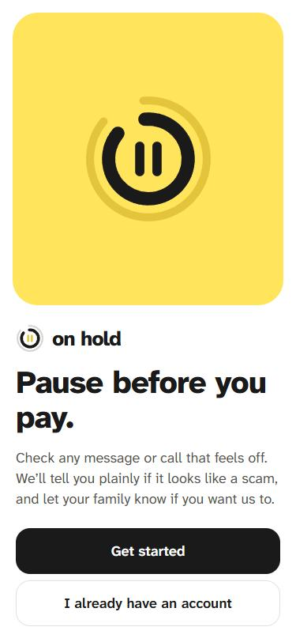<br/><sub>Welcome</sub></td>
  </tr>
  <tr>
    <th colspan="3">Admin panel</th>
  </tr>
  <tr>
    <td align="center">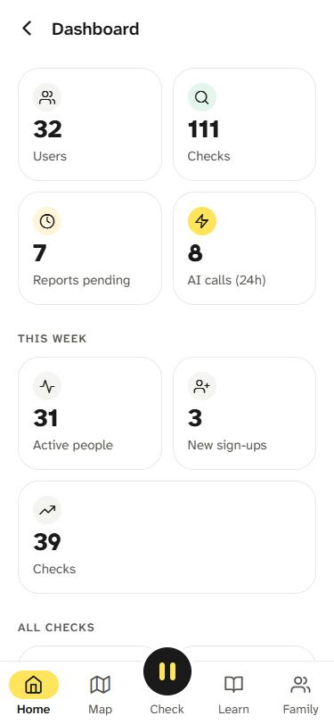<br/><sub>Dashboard</sub></td>
    <td align="center">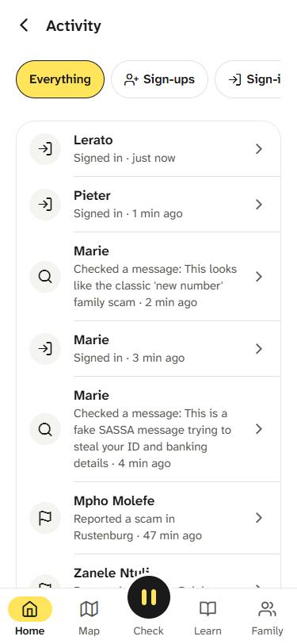<br/><sub>Who's doing what, live</sub></td>
    <td align="center">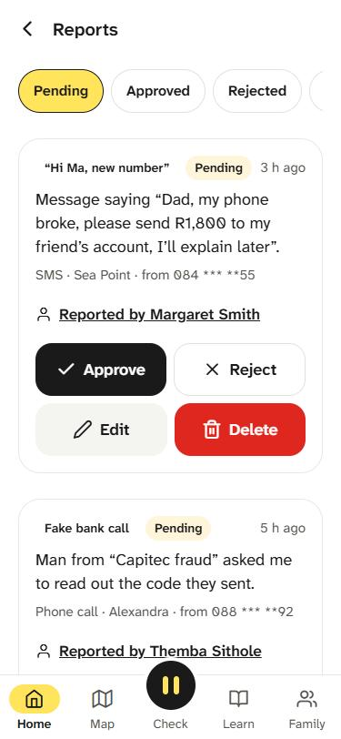<br/><sub>Approve or reject reports</sub></td>
  </tr>
  <tr>
    <td align="center">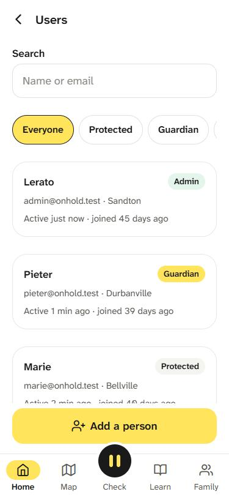<br/><sub>Users, most recently active first</sub></td>
    <td align="center">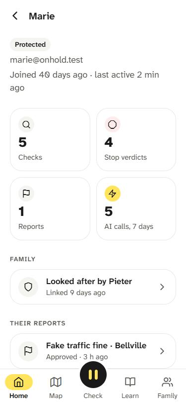<br/><sub>One person's history and family</sub></td>
    <td></td>
  </tr>
</table>

## Demo video

<!--
  To finish this section:
  1. Upload the video to YouTube as "Unlisted".
  2. Copy the video id: the part after "youtu.be/" or after "watch?v=" in its link.
  3. Replace both VIDEO_ID below with it, then delete this comment.
-->

[](https://youtu.be/VIDEO_ID)

A 6-minute walkthrough: signing in, checking a message, a screenshot and a call, a Stop reaching family, the map and Learn, and the admin panel (dashboard, activity, users, moderation).

## Using the app

Try it on the [website](https://onhold.pages.dev): the phone on the page is the real app. The demo accounts, all with password **onhold-demo**, are:

| Account | Role | Shows |
|---|---|---|
| `marie@onhold.test` | Protected | Home with recent checks, History, Family sharing toggles |
| `pieter@onhold.test` | Guardian | Marie's Stop alert under "Needs you", the alert timeline, invites |
| `admin@onhold.test` | Admin (Lerato) | The admin panel. This one has its own password (not `onhold-demo`), because an admin can delete people; access on request. |

**Getting around.** The tab bar is always there: **Home · Map · Check · Learn · Family**. The yellow button in the middle always starts a fresh check.

1. **Check something.** Tap **Check**. Paste text, tap **Screenshot**, or tap **Speak** and say what the caller said. The words appear in the box so you can fix them. Tap **Check it**, breathe with the ring, read the verdict. From the verdict you can **ask On Hold** a follow-up question, **Tell family**, or **Report it** so it reaches the map.
   - Try the example chips, or type "a man is phoning saying he's from the bank" (you get call advice without switching to call mode).
   - "Someone on the phone right now?" on Home opens call mode with safety basics shown straight away.
2. **Look after someone** (as Pieter). **Family → Invite someone** gives you a code to send. Alerts appear at the top of Home under "Needs you" and in the Family tab.
3. **Be looked after** (as Marie). **Family** shows who can see what; switch sharing on or off per person. Settings (the gear on Home) turns on simple mode.
4. **Map and Learn.** Filter the map by scam type; tap an area to see its count and a guide to spotting its most common scam. Learn opens all the guides.
5. **Moderate** (as an admin). **Home → Admin panel**: start at the **Dashboard**, open **Activity** to see what people are doing, **Reports** to approve or reject, and **Users** to open anyone's history or add a person.

## How it works

### Architecture

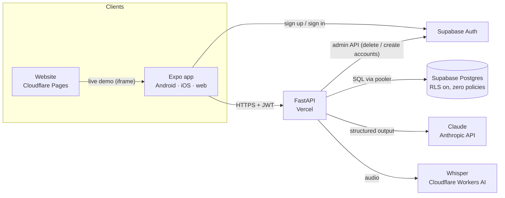

The app talks to Supabase **only to sign in**. Every piece of data goes through the API, which is the only thing that can read the database: row-level security is switched on for every table with no policies, so the public Supabase key exposes nothing. API keys (Anthropic, Cloudflare, the Supabase service role) live only on the server.

### A check, step by step

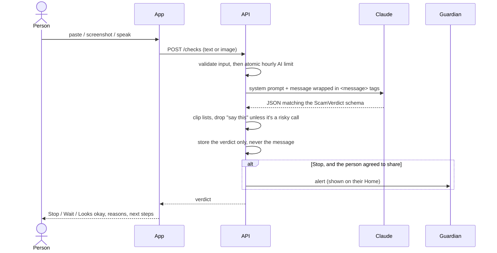

If Claude is down, times out, refuses or returns something off-schema, the app doesn't show a raw error. It shows **Wait**: "until you can check it, treat it as a scam", with Try again and Edit what I sent. The prompt design, output contract and failure paths are documented in [backend/docs/ai.md](backend/docs/ai.md).

### Data (ERD)

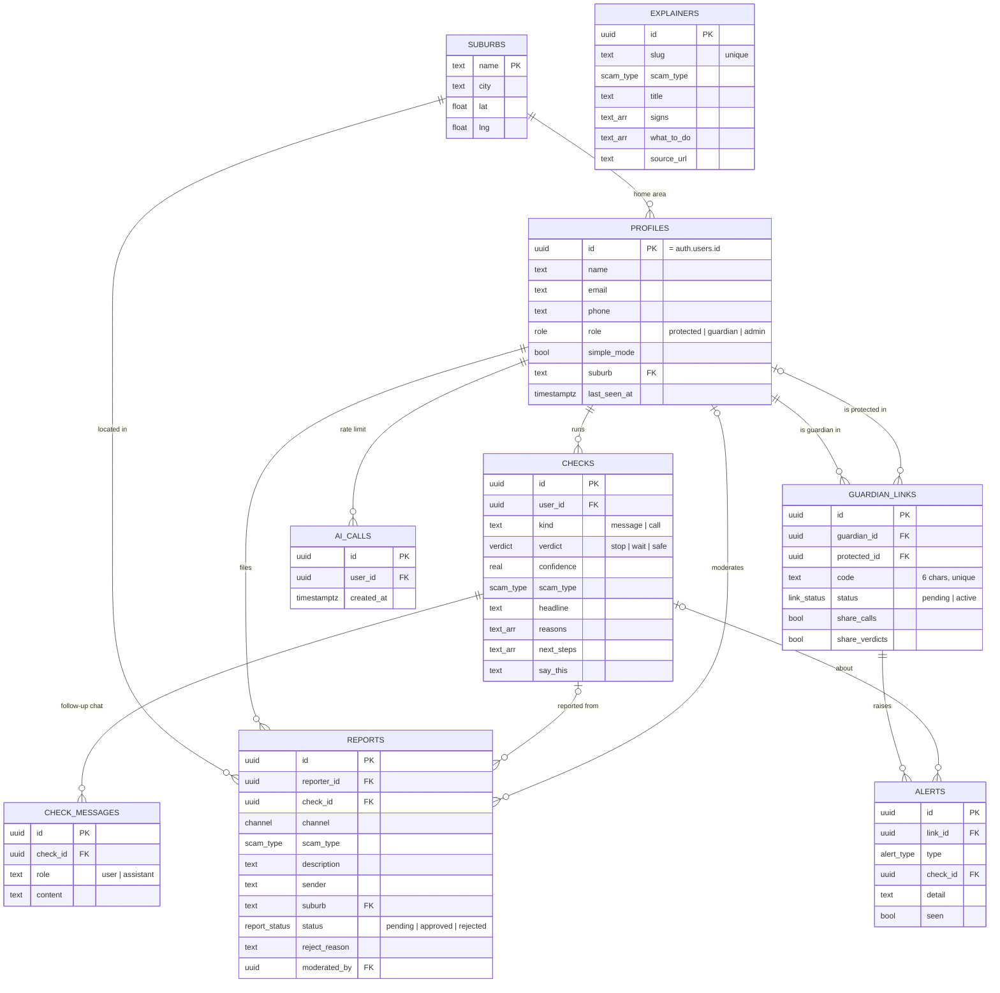

The schema lives in [supabase/migrations](supabase/migrations). Every route is listed in [backend/docs/api.md](backend/docs/api.md).

## Run it yourself

You need Node 20+, Python 3.12+ with [uv](https://docs.astral.sh/uv/), a free [Supabase](https://supabase.com) project and an [Anthropic API key](https://console.anthropic.com). Voice needs a free Cloudflare account (see below). On a phone, install **Expo Go**.

### 1. Database (Supabase)

```bash
npx supabase db push --db-url "<Session pooler connection string: Project Settings → Database>"
```

This creates every table, enum and trigger, plus the starting suburbs.

### 2. Backend (FastAPI)

```bash
cd backend
cp .env.example .env       # fill in the values below
uv sync
uv run python -m scripts.seed   # demo people, checks, reports, family links (safe to re-run)
uv run fastapi dev app/main.py  # http://localhost:8000, interactive docs at /docs
```

| Variable | What it is |
|---|---|
| `SUPABASE_URL` | Project URL |
| `SUPABASE_SERVICE_ROLE_KEY` | Service-role key. The server uses it only to create and delete accounts, and for seeding. |
| `DATABASE_URL` | Pooler connection string. On Vercel it must be the **transaction** pooler (port 6543): serverless instances freeze between requests and would hold the session pooler's 15 slots until every request hangs. |
| `ANTHROPIC_API_KEY` | Claude |
| `ANTHROPIC_MODEL` | Defaults to `claude-sonnet-5` |
| `CLOUDFLARE_ACCOUNT_ID`, `CLOUDFLARE_API_TOKEN` | Speech to text (a token from the "Workers AI" template) |
| `CORS_ORIGINS` | Comma-separated origins allowed to call the API, e.g. `http://localhost:8081` |
| `DEMO_HOOKS` | `true` makes any check containing `test-error` fail on purpose, to demo the failure screen |
| `ADMIN_PASSWORD` | Seed only: the admin demo account's password. Keep it private. |

The seed **rebuilds** the demo data every run, with dates relative to now, so the map and trends are always current. It only touches `@onhold.test` accounts. Every seeded person is fictional, emails use the reserved `.test` domain, demo phone numbers use the unallocated `+27 00` prefix, and sender numbers are masked. The scam patterns themselves are real ones, documented by SABRIC, SASSA, SARS, the RTIA and the FSCA.

### 3. App (Expo)

```bash
cd mobile
cp .env.example .env    # EXPO_PUBLIC_SUPABASE_URL, EXPO_PUBLIC_SUPABASE_KEY (publishable key), EXPO_PUBLIC_API_URL
npm install
npm run web    # browser at http://localhost:8081
npm start      # scan the QR code with Expo Go (Android) or the Camera app (iOS)
```

On a real phone, `EXPO_PUBLIC_API_URL` must be your computer's LAN address (e.g. `http://192.168.1.20:8000`), not `localhost`. Demo-account chips show on the sign-in screen in development builds.

### 4. Website

`website/` is plain HTML and CSS: open `website/index.html`, or serve the folder. See [website/README.md](website/README.md).

### Checks before committing

```bash
cd backend && uv run pytest
cd mobile && npx tsc --noEmit && npx expo lint && npx jest
```

## Deployment

Live now: the [website](https://onhold.pages.dev), the [app](https://onhold-app.pages.dev) and the [API](https://on-hold-ashen.vercel.app/docs) (its `/docs` page lets you try every route).

| Part | Where | How |
|---|---|---|
| Database + sign-in | Supabase | `supabase db push` (above) |
| API | Vercel, free tier | Import the GitHub repo, set the **root directory** to `backend`, and add the environment variables above. Vercel finds `app/main.py` and installs from `pyproject.toml`/`uv.lock` by itself; `backend/vercel.json` runs it in Frankfurt (`fra1`), next to the database. Set `CORS_ORIGINS` to the app's URL (the value only, not `CORS_ORIGINS=`) and `DATABASE_URL` to the transaction pooler (port 6543). |
| App (web build) | Cloudflare Pages | `cd mobile && EXPO_PUBLIC_API_URL=https://on-hold-ashen.vercel.app EXPO_PUBLIC_DEMO_ACCOUNTS=true npm run export:web`, then `npx wrangler pages deploy dist --project-name onhold-app`. The demo flag shows Marie and Pieter (never admin) on sign-in. The first time, create the project with `npx wrangler pages project create onhold-app --production-branch main --force` (without `--force`, newer wrangler tries to move it to Workers and fails). |
| Website | Cloudflare Pages | `npx wrangler pages deploy website --project-name onhold` |
| Android / iOS | Expo EAS | `eas build -p android --profile preview` (profiles in [mobile/eas.json](mobile/eas.json)). Store listing is next: "coming soon" on the website. |

## Technologies

<p>
  
</p>

| Layer | Choice | Why |
|---|---|---|
| App | Expo SDK 57, React Native 0.86, TypeScript, Expo Router | One codebase for Android, iOS and the web demo |
| Styling | `StyleSheet` + tokens in [theme.ts](mobile/src/theme.ts) | No styling build step to break |
| Map | react-native-maps (native), react-leaflet + OpenStreetMap (web) | react-native-maps has no web support |
| Inputs | expo-clipboard, expo-image-picker, expo-audio | All run in Expo Go |
| Auth | Supabase Auth (email + password), session kept with AsyncStorage | Real accounts and JWTs without building auth |
| API | FastAPI (Python), psycopg 3 on the Supabase pooler | Typed validation with Pydantic, `/docs` for free, Python per the brief |
| Database | Supabase Postgres, RLS on with no policies | The API is the only door |
| AI: verdicts | Claude (`claude-sonnet-5`) with structured outputs | Schema-valid JSON every time; strong at reading manipulation and tone. 5× cheaper than Opus for a free safety app. |
| AI: voice | Whisper (`whisper-large-v3-turbo`) on Cloudflare Workers AI | Claude doesn't take audio; free tier, server-side key |
| Hosting | Vercel (API), Cloudflare Pages (app + website), Supabase (data) | Free tiers that fit each part |
| CI | GitHub Actions | Tests, types and lint on every push |

## Security and privacy

- **The checked message or screenshot is never stored**, only the verdict. Scam texts often contain the victim's own account details. Follow-up questions are stored so History can show them, and can be deleted with the check.
- **Roles are enforced on the server** for every admin route. The app hides admin screens too, but that's only for navigation. Sign-up can only make a protected person or a guardian; admin is granted by another admin.
- **Every query is owner-scoped in SQL**, so one person can't read or change another's checks, reports or family links by guessing an id.
- **Consent first.** Guardians see only what the protected person chose to share, and that person can stop sharing at any time.
- **Prompt injection.** The message being checked is treated as data, never instructions. An embedded instruction is itself a red flag.
- **Abuse limits.** 30 AI calls per person per hour, enforced atomically (a Postgres advisory lock); request bodies capped at 4.5 MB.
- **Right to erasure.** People can delete a check, or their whole account and everything tied to it.
- **Admin safety.** Admins can't change their own role or delete themselves, and the last admin can't be removed (concurrent demotions are serialised with a row lock).

## Testing

The backend has route and AI-logic tests in pytest. The app has type checking, lint and jest tests. CI runs everything on every push. Every backend change was also checked live against the hosted database. The full approach, a bug log of everything found and fixed (with commits), and known limitations are in [docs/testing.md](docs/testing.md).

## Project management

### Features: Must / Nice / Future

| Must (MVP) | Nice (built) | Future |
|---|---|---|
| Check a message or call, with a Stop/Wait/Looks okay verdict, reasons and next steps | Follow-up chat on a verdict, saved to History | Mid-call auto-detect (needs a native build, Android first) |
| Screenshot and voice input for Check | Check history on Home | Push notifications for guardian alerts (currently in-app) |
| Sign up / sign in / sign out, protected/guardian/admin roles | Simple mode (one giant button) | SMS fallback alerts |
| Guardian invites, consent toggles, Stop-verdict alerts | "Tell my family" from any verdict | Forgot-password flow |
| Scam report create/read/update/delete, moderation queue | Admin activity feed and user history | App Store and Google Play release |
| Community map (suburb heat, type filter) + Learn tab | Public website with a live demo | — |

### Scope changes since the pitch

| Change | Why |
|---|---|
| **Learn tab and "Circulating now" moved into the MVP** | Awareness is a core goal, and the feed reuses moderated report data. |
| **Map shows a heat gradient, and the 5-report cutoff is gone** | Hiding small areas confused people. Privacy now comes from suburb-level data only (never exact addresses) plus moderation, and intensity reads better as heat than as number bubbles. |
| **Read-aloud (text-to-speech) removed** | On-device voices sounded robotic and added nothing over the large, plain-language screen. Voice *input* stays. |
| **Mid-call warning became call mode in Check** | Apps can't hear calls, and call-state detection needs a native build (Apple says CallKit's observer isn't meant for this). Call mode works everywhere today; `useOnCall()` is the hook for later. |
| **Voice uses Whisper on Cloudflare, not Claude** | Claude doesn't take audio. Whisper on Cloudflare Workers AI is free at this scale and keeps the key server-side. |
| **The role switcher in Settings is gone** | It previewed every role without signing out, for the early mock. Real roles come from Supabase Auth and can't be self-assigned. |
| **The raw message/screenshot is never stored** | Only the verdict, and any follow-up questions, are kept. Scam texts routinely contain the victim's own details. |
| **Admin panel grew from a moderation queue to full user insight** | Moderating well means knowing who's reporting and how active they are, so admins can now see activity and history, and add or edit people. |

### Risks and challenges

| Risk from the pitch | What happened | Status |
|---|---|---|
| **AI cost at scale** | Chose `claude-sonnet-5` over Opus (5× cheaper), plus an atomic per-user 30-calls/hour cap shared by checks, chat and voice. | Handled; revisit if usage grows |
| **A wrong or overconfident verdict** | Structured output plus an explicit "never say certainly safe" rule, and "On Hold can make mistakes" in the UI. | Handled, not eliminable |
| **Prompt injection via the scam text** | `<message>` tags with a treat-as-data instruction; an embedded instruction counts as a scam signal. | Handled ([ai.md](backend/docs/ai.md)) |
| **Call detection isn't available in Expo Go** | Confirmed. Shipped manual call mode instead. | Remains |
| **No local Docker during the build** | Worked against the hosted Supabase project directly, with more care before destructive migrations. | Workaround |
| **Privacy of what's being checked** | Surfaced during the build: the raw message is never stored. | Resolved by design |
| **Free hosting limits** | Vercel caps request bodies at 4.5 MB; the API matches it and the app explains it. | Handled |

### Git workflow

`main` (demo-ready) ← `dev` (integration) ← `feature/*` / `fix/*` / `chore/*` branches, merged with `--no-ff`, using [Conventional Commits](https://www.conventionalcommits.org/).

## Money model (if it ever launches)

**Safety is never paywalled.** Checks, verdicts, Learn, the map and one guardian link stay free. An optional paid **Family plan** would cover looking after several people, SMS fallback alerts and a weekly digest. No ads and no selling data.

## Contributions

A solo project: Victor du Preez designed, built, tested and documented it. Claude Code (Anthropic) was used as a coding assistant throughout.

## Acknowledgements

- Scam guidance checked against [SABRIC](https://www.sabric.co.za/), [SASSA via SAnews](https://www.sanews.gov.za/node/60295), [SARS](https://www.sars.gov.za/media-release/11-february-2013-warning-to-taxpayers-on-scams/), [RTIA / AARTO via SAnews](https://www.sanews.gov.za/node/84463), the [FSCA](https://www.fsca.co.za/) and [Arcadia Finance](https://www.arcadiafinance.co.za/news/older-sassa-beneficiaries-targeted-by-scammers/). Statistics in the pitch come from SABRIC (2026).
- AI: [Claude](https://www.anthropic.com/claude) by Anthropic; [Whisper](https://github.com/openai/whisper) by OpenAI, served by [Cloudflare Workers AI](https://developers.cloudflare.com/workers-ai/).
- [Atkinson Hyperlegible Next](https://www.brailleinstitute.org/freefont) by the Braille Institute (SIL OFL), via `@expo-google-fonts`.
- Icons: [Feather](https://feathericons.com/) via `@expo/vector-icons`. Web map tiles © [OpenStreetMap](https://www.openstreetmap.org/copyright) contributors.
